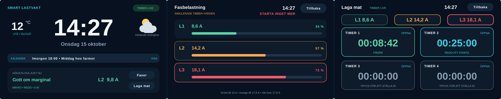

# Smart lastvakt

En svensk klocka och fasvakt för **Waveshare ESP32-S3-Touch-LCD-4.3B-BOX** (800 × 480, ESP32-S3-N16R8). Projektet visar Tibber Pulse-strömmarna för L1, L2 och L3 och växlar automatiskt till fasvyn när någon fas går in i den röda zonen.

Standardvärdet för huvudsäkringen är **25 A**.

För projektets samlade mål, aktuella status, fattade beslut, säkerhetsprinciper, prioriterade nästa steg och överlämning till nya trådar, börja med **[PROJECT-STATUS.md](PROJECT-STATUS.md)**. Elektriska apparatuppgifter och ännu öppna frågor om COALA och elpatronen finns i [HARDWARE-NOTES.md](HARDWARE-NOTES.md).

En frikopplad, datorbaserad referensmodell för framtida tvåstegsstyrning finns beskriven i [LOAD-GUARD-POLICY.md](LOAD-GUARD-POLICY.md). Den används för simulering och tester och är inte ansluten till firmware eller fysiska reläer.



## Funktioner

- Extra stor klocka, svenskt datum och automatisk CET/CEST.
- Aktuell utetemperatur i Älvsjö och ritade väderikoner för dag, natt, moln, dimma, regn, snö och åska. Vädret uppdateras var 15:e minut via [Open-Meteo](https://open-meteo.com/).
- Kortets batteribackade PCF85063A används vid start; NTP rättar tiden efter Wi-Fi-anslutning.
- Tryck på **SMART LASTVAKT** för en ren systemstatussida med Wi-Fi, tidskälla, Tibber, kalender och en QR-kod till enhetens lokala installationssida.
- Nästa händelse från familjens privata Google-kalender visas direkt på klockvyn. Tryck på kalenderfältet för en egen sida med de sex närmaste händelserna.
- Kalenderemoji som den inbyggda skärmfonten inte kan rita ersätts med en ren punktmarkör i stället för tomma teckenrutor.
- Kalendern uppdateras var 15:e minut och vanliga dagliga, veckovisa, månatliga och årliga upprepningar stöds.
- Tibber GraphQL-abonnemang med `currentL1`, `currentL2` och `currentL3` i realtid.
- Lokal mätning från Shelly Plug S Gen3: **REDO**, **KÖR** eller **STRÖMLÖS** och aktuell effekt på huvudvyn samt ström, spänning och temperatur på en egen Shelly-sida.
- Skyddad manuell relästyrning: tryck på mikroraden, håll styrknappen i två sekunder och bekräfta därefter ändringen i ett separat dialogfönster.
- Simulerade fasvärden används automatiskt tills Tibber är konfigurerat eller om liveflödet är tillfälligt nere.
- Tydliga belastningszoner: grönt till 10 A, orange till 17,5 A och rött över 17,5 A med 25 A huvudsäkring.
- Automatisk fasvy i röd zon och återgång efter åtta sekunder.
- Manuell växling mellan klocka, kalender och fasvy via pekskärmen.
- Lokal installationssida för SSID, Wi-Fi-lösenord, Tibber Personal Access Token, kalenderns hemliga iCal-adress och Shelly-adress.

## Planerade familjefunktioner

- En enkel gemensam inköpslista med möjlighet att lägga till exempelvis ”mjölk” från mobil eller display.
- Säker automatisk lastfrånkoppling för mikron efter att installationen och mikrons verkliga förbrukning har verifierats på plats.
- Pris- och fasstyrd begränsning av elpatronens två effektsteg som ett smart tillägg i serie med den separata COALA-vakten. Verifierade apparatuppgifter och öppna konstruktionsfrågor finns i [HARDWARE-NOTES.md](HARDWARE-NOTES.md).

Kalendern läses skrivskyddat via Googles hemliga iCal-adress. Adressen lagras endast på enheten, aldrig i Git-förrådet eller i loggarna.

## Första starten

1. Starta displayen och anslut en mobil eller dator till nätverket `Lastvakt-Setup-XXXX`.
2. Öppna `http://192.168.4.1`.
3. Fyll i Wi-Fi-namn, Wi-Fi-lösenord, din Tibber Personal Access Token, kalenderns **Hemliga adress i iCal-format** från Google Kalender och Shelly-pluggens lokala IP-adress.
4. Tryck **Spara och starta om**.

Efter en lyckad anslutning finns adressen och en skanningsbar QR-kod på systemstatussidan. Tryck på **SMART LASTVAKT** på huvudvyn för att öppna den. Mobilen måste vara ansluten till samma lokala nätverk. Om Wi-Fi-anslutningen misslyckas startas installationsnätverket igen.

En personlig token kan skapas på [Tibber Developer](https://developer.tibber.com/). Firmware väljer automatiskt det första hem där realtidsmätning är aktiverad och sparar hem-id lokalt.

### Sekretess och säkerhet

SSID, lösenord, Tibber-token, kalenderadress och Shelly-adress lagras i ESP32-enhetens NVS-minne och skrivs aldrig till projektfiler eller loggar. Installationssidan använder vanlig lokal HTTP och saknar egen inloggning; använd den därför bara på ett betrott hemnätverk och låt inte installationsnätverket vara åtkomligt längre än nödvändigt. Reläet kan bara ändras från Shelly-sidan efter både ett två sekunder långt tryck och en separat bekräftelse.

## Bygga

Projektet använder ESP-IDF 5.5.5. Hanterade komponenter hämtas automatiskt vid första byggningen.

```powershell
idf.py set-target esp32s3
idf.py build
```

## Testa styrprincipen utan hårdvara

Referensmodellen använder endast Pythons standardbibliotek:

```powershell
python -m unittest discover -s tests -v
python -m tools.simulate_load_guard
```

Exempelvärdena är inte installationsinställningar. Modellen har inga fysiska utgångar.

## Flasha

```powershell
idf.py -p COM11 flash monitor
```

De tre färdiga bilderna ligger även i `firmware/` och har följande offset:

| Fil | Offset |
|---|---:|
| `bootloader.bin` | `0x0000` |
| `partition-table.bin` | `0x8000` |
| `lastvakt_display.bin` | `0x10000` |

## Inställningar

`idf.py menuconfig` → **Example Configuration → Smart lastvakt** innehåller:

- huvudsäkring per fas, standard 25 A;
- gränser för orange och röd zon, standard 40 respektive 70 % av huvudsäkringen;
- hur länge fasvyn ligger kvar efter varningen, standard 8 sekunder.

## Struktur

- `main/network_setup.c` – Wi-Fi, NVS och den lokala installationssidan.
- `main/calendar_source.c` – hämtar, tolkar och sorterar kommande kalenderhändelser från privat iCal.
- `main/weather_source.c` – hämtar aktuellt väder för Älvsjö och behåller senaste värdet vid tillfälliga anslutningsfel.
- `main/shelly_client.c` – hämtar reläläge och elmätvärden och verkställer bekräftade reläkommandon i bakgrunden på det lokala nätverket.
- `main/tibber_client.c` – Tibbers GraphQL- och WebSocket-klient.
- `main/phase_source.c` – väljer livevärden eller simulering.
- `main/app_time.c` – RTC, NTP och svensk tidszon.
- `main/ui.c` – LVGL-gränssnittet och vyväxlingen.
- `main/fonts/lv_font_lastvakt_48.c` – stor skärmfont med svenska Å, Ä och Ö för Shelly-lägena.

Kort- och bildskärmsinitieringen bygger på Waveshares officiella LVGL v8-exempel för kortet. Se [BUILD-REPORT.md](BUILD-REPORT.md) för den provade bygg- och enhetsstatusen.
